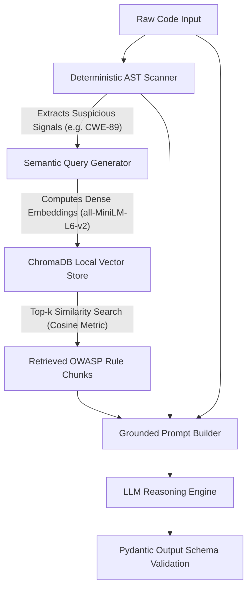
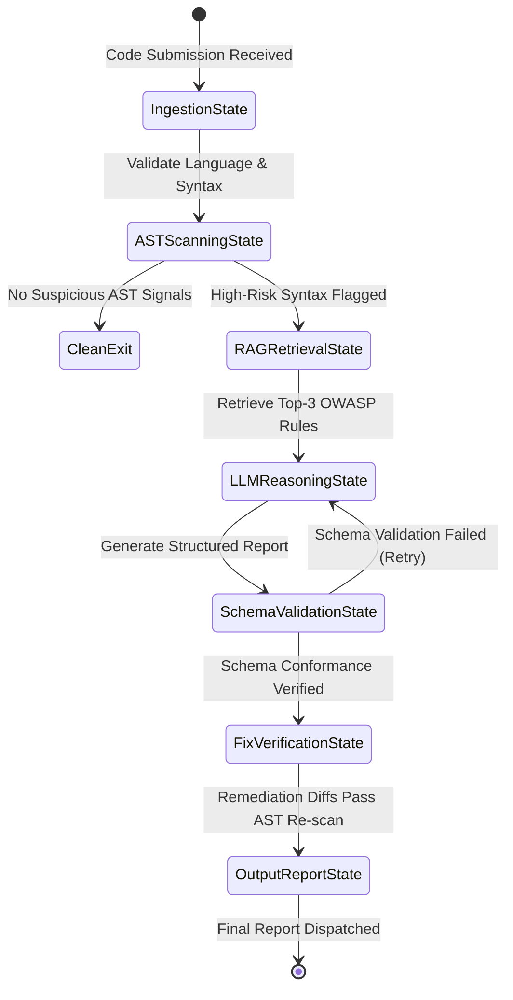

# Comprehensive Engineering Handbook & Study Notes: Code Review & Security Analysis Agent
OWASP Top 10:2025 Enterprise Edition | Static Analysis (AST) | RAG Pipeline | Clean Code Refactoring

**Document Metadata:**
- **System:** Code Review & Security Analysis Agent | **Target Languages:** Python (3.10+) & Java (JDK 17+)
- **Security Standard:** OWASP Top 10:2025, CWE Top 25, NIST SP 800-53
- **Architectural Paradigm:** Deterministic Static Analysis (AST) + Semantic RAG (ChromaDB) + LLM Reasoning
- **Classification:** Internal Engineering Handbook & Reference Specification

---

## 1. OWASP Top 10:2025 Comprehensive Taxonomy & Evolution

The OWASP Top 10:2025 reflects modern threats across cloud-native architectures, microservices, containerization, and AI/LLM-assisted software supply chains.

### 1.1 Comparative Matrix: OWASP 2021 vs. OWASP 2025

| OWASP 2025 ID | Category Name (2025) | 2021 Rank | Core CWEs | Strategic Shift & Industry Threat Impact |
|:--------------|:---------------------|:----------|:----------|:-----------------------------------------|
| **A01:2025** | Broken Access Control | A01:2021 | CWE-639, CWE-22, CWE-285, CWE-862 | Retains #1 rank. Dominates microservices, multi-tenant APIs, and IDOR vectors. |
| **A02:2025** | Security Misconfiguration | A05:2021 | CWE-16, CWE-209, CWE-942, CWE-1004 | Rises due to complex cloud, Kubernetes, CORS, and unhardened default configs. |
| **A03:2025** | Software Supply Chain Failures | A06:2021 | CWE-1395, CWE-1104, CWE-829, CWE-494 | **NEW FOCUS:** Build-pipeline tampering, dependency confusion, unverified hashes. |
| **A04:2025** | Cryptographic Failures | A02:2021 | CWE-327, CWE-328, CWE-326, CWE-330 | Deprecated algorithms (MD5/SHA1), broken key derivation, lack of forward secrecy. |
| **A05:2025** | Injection | A03:2021 | CWE-89, CWE-78, CWE-79, CWE-1336 | Unified category: SQLi, OS Command Injection, XSS, LDAP, and SSTI. |
| **A06:2025** | Insecure Design | A04:2021 | CWE-840, CWE-307, CWE-602, CWE-311 | Pre-coding architectural defects, lack of threat modeling, flawed business logic. |
| **A07:2025** | Authentication Failures | A07:2021 | CWE-798, CWE-384, CWE-287, CWE-306 | Hardcoded credentials, credential stuffing, lack of MFA, improper session timeout. |
| **A08:2025** | Software & Data Integrity Failures | A08:2021 | CWE-502, CWE-829, CWE-494, CWE-915 | Insecure deserialization (`pickle`, Java `ObjectInputStream`), unverified updates. |
| **A09:2025** | Security Logging & Alerting Failures | A09:2021 | CWE-778, CWE-117, CWE-532, CWE-223 | Missing high-fidelity audit trails, log injection (CRLF), plaintext PII in logs. |
| **A10:2025** | Mishandling of Exceptional Conditions | **NEW (2025)** | CWE-391, CWE-636, CWE-775, CWE-209 | **NEW CATEGORY:** Bare except clauses, fail-open auth, unreleased resource leaks. |

### 1.2 Deep Dive into Key 2025 Architectural Shifts
- **A03:2025 Software Supply Chain Failures:** Up to 90% of modern applications rely on open-source dependencies. Key vectors include dependency confusion (typosquatting on public registries), unpinned transitive dependencies (`requests>=2.0.0`), and missing SHA-256 integrity hash verification in manifests.
- **A10:2025 Mishandling of Exceptional Conditions:** Highlights catastrophic error-handling failures: fail-open authentication gates when identity providers time out, bare `except:` swallowing critical failures, and diagnostic leakage returning internal stack traces to clients.

---

## 2. In-Depth Vulnerability Catalog (Complete Python & Java Implementations)

Benchmark catalog covering 17 critical vulnerabilities with vulnerable/remediated pairs in Python and Java, AST detection logic, and RAG knowledge base keys.

### 2.1 SQL Injection (SQLi)
- **OWASP / CWE / CVSS:** A05:2025 - Injection | CWE-89 | CVSS 9.8 (Critical)
- **Root Cause:** Untrusted user input is concatenated or formatted directly into dynamic SQL queries instead of being bound as parameters.
```python
# VULNERABLE: Direct f-string interpolation into SQL statement
cursor.execute(f"SELECT id, role FROM accounts WHERE user = '{username}' AND pass = '{pass_hash}'")
# SECURE: Parameterized query enforces strict separation of query logic and untrusted data
cursor.execute("SELECT id, role FROM accounts WHERE user = ? AND pass = ?", (username, pass_hash))
```
```java
// VULNERABLE: Concatenation allows query syntax manipulation
Statement stmt = conn.createStatement();
ResultSet rs = stmt.executeQuery("SELECT id FROM accounts WHERE user = '" + username + "' AND pass = '" + pass + "'");
// SECURE: PreparedStatement compiles query template on the DB server prior to parameter binding
try (PreparedStatement pstmt = conn.prepareStatement("SELECT id FROM accounts WHERE user = ? AND pass = ?")) {
    pstmt.setString(1, username); pstmt.setString(2, pass);
    ResultSet rs = pstmt.executeQuery();
}
```
- **Detection & AST:** Python AST flags `ast.Call` on `execute()` with `ast.BinOp` (`+`, `%`) or `ast.JoinedStr`. Java AST matches `Statement.executeQuery/Update` containing binary addition with identifiers. RAG: `owasp_sqli_cheatsheet`, `parameterized_queries`.

### 2.2 Cross-Site Scripting (XSS) - Reflected & Stored
- **OWASP / CWE / CVSS:** A05:2025 - Injection | CWE-79 | CVSS 8.8 (High)
- **Root Cause:** Untrusted input is reflected into HTTP responses or templates without contextual encoding.
```python
# VULNERABLE: Direct interpolation into rendered HTML template string
return render_template_string(f"<h1>Search Results for: {request.args.get('q')}</h1>")
# SECURE: Contextual escaping or passing variables into Jinja2 template context
return render_template_string("<h1>Search Results for: {{ search_query }}</h1>", search_query=request.args.get("q"))
```
```java
// VULNERABLE: Direct write to response stream without encoding
out.println("<html><body><h1>Welcome back, " + req.getParameter("username") + "!</h1></body></html>");
// SECURE: Contextual HTML entity encoding transforms dangerous glyphs (<, >, &, ", ')
String safeUser = org.owasp.encoder.Encode.forHtml(req.getParameter("username"));
out.println("<html><body><h1>Welcome back, " + safeUser + "!</h1></body></html>");
```
- **Detection & AST:** Flag calls to `render_template_string` or raw HTTP response writers (`response.write`, `out.println`) concatenating request parameters. RAG: `owasp_xss_cheatsheet`, `contextual_encoding`.

### 2.3 Operating System Command Injection
- **OWASP / CWE / CVSS:** A05:2025 - Injection | CWE-78 | CVSS 9.8 (Critical)
- **Root Cause:** Passing unsanitized input to system shells (`sh`, `cmd.exe`) where metacharacters (`;`, `|`, `&&`) execute arbitrary commands.
```python
# VULNERABLE: Shell metacharacter injection via string concatenation
os.system("ping -c 1 " + host_ip)
# SECURE: Strict allow-list validation + direct binary execution without invoking a shell
if not re.fullmatch(r"^[0-9a-zA-Z.-]+$", host_ip): raise ValueError("Invalid host")
subprocess.run(["ping", "-c", "1", host_ip], capture_output=True, text=True, check=True, timeout=5)
```
```java
// VULNERABLE: Command string executed in runtime shell environment
Runtime.getRuntime().exec("ping -c 1 " + target);
// SECURE: ProcessBuilder invokes kernel execve directly without a shell interpreter
ProcessBuilder pb = new ProcessBuilder("ping", "-c", "1", target);
Process process = pb.start();
```
- **Detection & AST:** Flag `os.system()`, `os.popen()`, `subprocess.Popen(..., shell=True)` in Python; `Runtime.getRuntime().exec(String)` in Java. RAG: `command_injection_prevention`, `process_builder`.

### 2.4 Server-Side Template Injection (SSTI)
- **OWASP / CWE / CVSS:** A05:2025 - Injection | CWE-1336 | CVSS 9.0 (Critical)
- **Root Cause:** Embedding untrusted input into template source code prior to compilation rather than passing it as data context.
```python
# VULNERABLE: Dynamic template string compilation allows sandbox escape
template = Environment().from_string(f"Hello {request.args.get('name')}!")
# SECURE: Static template with user variables passed strictly as evaluation context
template = Environment(autoescape=True).from_string("Hello {{ name }}!")
return template.render(name=request.args.get("name"))
```
```java
// VULNERABLE: Dynamic template compilation allows instantiation of Execute utility
Template t = new Template("mail", new StringReader("Dear " + userGreeting + "..."), cfg);
// SECURE: Static precompiled template with user variables bound in data model
Template t = cfg.getTemplate("mail_order.ftl");
model.put("userGreeting", userGreeting);
t.process(model, out);
```
- **Detection & AST:** Detection of `from_string()` or `Template(StringReader)` when arguments derive from external request parameters. RAG: `SSTI_prevention`, `jinja2_sandbox`.

### 2.5 Hardcoded Sensitive Credentials & Secrets
- **OWASP / CWE / CVSS:** A07:2025 - Authentication Failures | CWE-798 | CVSS 8.9 (High)
- **Root Cause:** Storing plaintext API keys, tokens, or database passwords directly within source files committed to version control.
```python
# VULNERABLE: Committed secret keys
STRIPE_API_KEY = "sk_test_placeholder_stripe_api_key_example"
# SECURE: Externalized configuration loaded from environment or secrets manager
STRIPE_API_KEY = os.environ.get("STRIPE_API_KEY")
if not STRIPE_API_KEY: raise RuntimeError("Missing mandatory STRIPE_API_KEY")
```
```java
// VULNERABLE: Hardcoded credential constant
public static final String DB_PASS = "SuperSecretAdminPassword123!";
// SECURE: Spring @Value injected at runtime from vault or environment
@Value("${spring.datasource.password}")
private String dbPassword;
```
- **Detection & AST:** Variable name heuristic (`PASSWORD`, `SECRET`, `API_KEY`, `TOKEN`) paired with Shannon entropy calculation ($H > 3.5$). RAG: `owasp_secrets_cheatsheet`, `vault_integration`.

### 2.6 Weak Password Hashing & Inadequate Salt Work Factors
- **OWASP / CWE / CVSS:** A04:2025 - Cryptographic Failures | CWE-327 / CWE-328 | CVSS 7.5 (High)
- **Root Cause:** Using fast digest algorithms (MD5, SHA-1, plain SHA-256) lacking cryptographic salt and adaptive work factors.
```python
# VULNERABLE: Fast unsalted hash is vulnerable to precomputed rainbow tables
return hashlib.md5(password.encode("utf-8")).hexdigest()
# SECURE: Adaptive work factor with unique per-user cryptographic salt
salt = bcrypt.gensalt(rounds=12)
return bcrypt.hashpw(password.encode("utf-8"), salt).decode("utf-8")
```
```java
// VULNERABLE: SHA-1 message digest is vulnerable to collision attacks
MessageDigest md = MessageDigest.getInstance("SHA-1");
// SECURE: Argon2id (OWASP recommended standard) memory-hard password encoder
PasswordEncoder encoder = new Argon2PasswordEncoder(16, 32, 1, 65536, 3);
return encoder.encode(password);
```
- **Detection & AST:** Flag imports/calls to `hashlib.md5()`, `hashlib.sha1()`, or Java `MessageDigest.getInstance("MD5"|"SHA-1")` linked to password variables. RAG: `password_storage_cheatsheet`, `argon2id`.

### 2.7 Insecure Symmetric Cipher Modes & Predictable IVs
- **OWASP / CWE / CVSS:** A04:2025 - Cryptographic Failures | CWE-326 / CWE-329 | CVSS 7.5 (High)
- **Root Cause:** Electronic Codebook (ECB) mode preserves plaintext patterns; CBC mode with static IVs lacks cryptographic integrity.
```python
# VULNERABLE: ECB mode leaks structural patterns of encrypted plaintext
cipher = AES.new(key, AES.MODE_ECB)
# SECURE: AES-GCM provides authenticated encryption with integrity tag (AEAD)
nonce = get_random_bytes(12); cipher = AES.new(key, AES.MODE_GCM, nonce=nonce)
ciphertext, tag = cipher.encrypt_and_digest(plaintext)
```
```java
// VULNERABLE: 56-bit DES with ECB mode
Cipher cipher = Cipher.getInstance("DES/ECB/PKCS5Padding");
// SECURE: AES-256 with Galois/Counter Mode (GCM) and secure random IV
Cipher cipher = Cipher.getInstance("AES/GCM/NoPadding");
byte[] iv = new byte[12]; SecureRandom.getInstanceStrong().nextBytes(iv);
cipher.init(Cipher.ENCRYPT_MODE, key, new GCMParameterSpec(128, iv));
```
- **Detection & AST:** Flag literal strings `AES.MODE_ECB`, `DES`, `DESede`, or `Cipher.getInstance("DES.*"|"AES/ECB/.*")`. RAG: `cryptographic_storage_cheatsheet`, `AES_GCM_mode`.

### 2.8 Broken Access Control & Insecure Direct Object References (IDOR)
- **OWASP / CWE / CVSS:** A01:2025 - Broken Access Control | CWE-639 | CVSS 8.5 (High)
- **Root Cause:** Retrieving sensitive records by client-supplied ID without asserting authenticated user ownership or tenancy boundaries.
```python
# VULNERABLE: Direct lookup allows User A to view User B's invoice
invoice = db.query(Invoice).filter(Invoice.id == invoice_id).first()
# SECURE: Query strictly scopes retrieval to current authenticated user's tenant ID
invoice = db.query(Invoice).filter(Invoice.id == invoice_id, Invoice.owner_user_id == current_user.id).first()
if not invoice: raise HTTPException(status_code=404, detail="Resource not found")
```
```java
// VULNERABLE: Direct entity fetch by path variable without principal check
return documentService.findById(docId);
// SECURE: Domain repository verifies ownership against authenticated caller principal
@PreAuthorize("hasPermission(#docId, 'Document', 'READ')")
return documentService.findByIdAndOwner(docId, principal.getTenantId())
    .orElseThrow(() -> new ResourceNotFoundException("Document unavailable"));
```
- **Detection & AST:** Detect ORM `findById(param)` calls where `param` comes from path/body and no ownership filters exist. RAG: `access_control_cheatsheet`, `IDOR_prevention`.

### 2.9 Path Traversal & Arbitrary File Disclosure
- **OWASP / CWE / CVSS:** A01:2025 - Broken Access Control | CWE-22 | CVSS 8.6 (High)
- **Root Cause:** Concatenating user input into file paths allowing `../` sequences to escape the storage root directory.
```python
# VULNERABLE: Directory traversal allows reading /etc/passwd via ?file=../../../../etc/passwd
file_path = os.path.join("/var/www/uploads", filename)
# SECURE: Canonicalize path and verify it remains strictly within upload root
target_path = (UPLOAD_DIR / filename).resolve()
if not target_path.is_relative_to(UPLOAD_DIR) or not target_path.is_file(): abort(403, "Access forbidden")
return send_file(target_path)
```
```java
// VULNERABLE: Unchecked file creation allows traversal
File target = new File("/data/storage/" + userPath);
// SECURE: Normalize path and assert canonical prefix containment
Path resolved = BASE_PATH.resolve(userPath).normalize();
if (!resolved.startsWith(BASE_PATH) || !resolved.toFile().isFile()) {
    throw new SecurityException("Directory traversal attempt detected");
}
return new FileInputStream(resolved.toFile());
```
- **Detection & AST:** Flag calls to `open()`, `send_file()`, `FileInputStream` where paths concatenate variables without `.resolve()` and containment checks. RAG: `path_traversal_cheatsheet`, `canonical_path`.

### 2.10 Cross-Site Request Forgery (CSRF)
- **OWASP / CWE / CVSS:** A01:2025 - Broken Access Control | CWE-352 | CVSS 7.1 (High)
- **Root Cause:** State-changing endpoints rely exclusively on ambient browser cookies without verifying origin synchronizer tokens.
```python
# VULNERABLE: State-changing POST route lacks CSRF validation
@app.route("/account/change-email", methods=["POST"])
def change_email(): db.update_email(session["user_id"], request.form.get("email"))
# SECURE: Global CSRF protection with Strict SameSite cookie policy
csrf = CSRFProtect(app)
app.config.update(SESSION_COOKIE_SECURE=True, SESSION_COOKIE_HTTPONLY=True, SESSION_COOKIE_SAMESITE="Strict")
```
```java
// VULNERABLE: Disabling CSRF protection opens state mutations to forgery
http.csrf(csrf -> csrf.disable());
// SECURE: Enforce Synchronizer Token Pattern with Cookie repository
http.csrf(csrf -> csrf.csrfTokenRepository(CookieCsrfTokenRepository.withHttpOnlyFalse()));
```
- **Detection & AST:** Flag explicit calls disabling CSRF (`csrf.disable()`) or POST handlers lacking token validation. RAG: `csrf_prevention_cheatsheet`, `samesite_cookies`.

### 2.11 Security Misconfiguration & Production Debug Leaks
- **OWASP / CWE / CVSS:** A02:2025 - Security Misconfiguration | CWE-209 / CWE-16 | CVSS 7.5 (High)
- **Root Cause:** Deploying interactive debuggers, verbose stack traces, or wildcard CORS headers into production environments.
```python
# VULNERABLE: Debug mode enabled in production leaks environment and schemas
DEBUG = True; ALLOWED_HOSTS = ["*"]
# SECURE: Environment-driven debug flag; sanitize user-facing errors with request correlation ID
app.config["DEBUG"] = os.getenv("FLASK_DEBUG", "False").lower() in ("true", "1")
@app.errorhandler(Exception)
def handle_error(e):
    logger.error("Internal error: %s", str(e), exc_info=True)
    return jsonify({"error": "An error occurred", "incident_id": request.headers.get("X-Request-ID")}), 500
```
```yaml
# VULNERABLE: Actuator exposes heapdumps and environment variables
management.endpoints.web.exposure.include: "*"
server.error.include-stacktrace: always
# SECURE: Least privilege health probes; stack traces suppressed
management.endpoints.web.exposure.include: "health,info"
server.error.include-stacktrace: never
```
- **Detection & AST:** Flag `DEBUG = True` assignments in Python settings or Spring configs exposing `include: "*"`. RAG: `security_misconfiguration_cheatsheet`, `error_handling`.

### 2.12 Software Supply Chain Vulnerabilities & Dependency Poisoning
- **OWASP / CWE / CVSS:** A03:2025 - Software Supply Chain Failures | CWE-1395 | CVSS 8.8 (High)
- **Root Cause:** Loose version bounds and missing cryptographic hashes allow dependency confusion, typosquatting, and compromised upstream code.
```text
# VULNERABLE: Unpinned versions and unauthenticated registries
requests>=2.20.0
flask
# SECURE: Exact version pinning with SHA-256 integrity hash verification
requests==2.32.3 --hash=sha256:70761ce403c6218f0a068f63567d2644265d6484e680a6b7e7...
flask==3.0.3 --hash=sha256:a6b245037d45763a1fa0675704a4347db7e94e775bf9fe2e...
# CI Verification: pip-audit -r requirements.txt && pip install --require-hashes -r requirements.txt
```
```xml
<!-- VULNERABLE: Outdated Log4j (CVE-2021-44228) over insecure HTTP repo -->
<dependency><groupId>org.apache.logging.log4j</groupId><artifactId>log4j-core</artifactId><version>2.14.1</version></dependency>
<!-- SECURE: Patched version + automated OWASP dependency-check-maven scanner -->
<dependency><groupId>org.apache.logging.log4j</groupId><artifactId>log4j-core</artifactId><version>2.24.1</version></dependency>
<plugin><groupId>org.owasp</groupId><artifactId>dependency-check-maven</artifactId><version>10.0.4</version></plugin>
```
- **Detection & AST:** Ingestion scanner flags `requirements.txt` entries without `==` or missing `--hash`. RAG: `supply_chain_cheatsheet`, `pip_audit`.

### 2.13 Insecure Deserialization & Remote Code Execution (RCE)
- **OWASP / CWE / CVSS:** A08:2025 - Software & Data Integrity Failures | CWE-502 | CVSS 9.8 (Critical)
- **Root Cause:** Deserializing untrusted object streams using native engines (`pickle`, Java `ObjectInputStream`), allowing gadget chain execution.
```python
# VULNERABLE: Deserializing untrusted pickle triggers arbitrary code via __reduce__
user_state = pickle.loads(base64.b64decode(request.json.get("state")))
# SECURE: Strict schema validation over declarative, standardized JSON payloads
class StateModel(BaseModel): user_id: int; preferences: dict = Field(default_factory=dict)
state = StateModel.model_validate(request.json)
```
```java
// VULNERABLE: ObjectInputStream triggers arbitrary bytecode execution
ObjectInputStream ois = new ObjectInputStream(networkStream);
return ois.readObject();
// SECURE: Parse strictly to concrete DTO class without polymorphic type handling
ObjectMapper mapper = new ObjectMapper();
return mapper.readValue(networkStream, UserProfileDTO.class);
```
- **Detection & AST:** Flag `pickle.loads`, `pickle.load`, `_pickle`, `yaml.load` (without `SafeLoader`); and Java `new ObjectInputStream()`. RAG: `deserialization_cheatsheet`, `safe_json_parsing`.

### 2.14 Insecure Architectural Design & Business Logic Price Tampering
- **OWASP / CWE / CVSS:** A06:2025 - Insecure Design | CWE-840 | CVSS 8.1 (High)
- **Root Cause:** Trusting client-supplied financial totals or discounts instead of computing monetary invariants authoritatively on the server.
```python
# VULNERABLE: Client sends final charge amount directly
total_to_charge = request.json.get("client_total"); payment_processor.charge(amount=total_to_charge)
# SECURE: Server calculates monetary totals authoritatively against database records
authoritative_total = sum(db.query(Product).get(i["id"]).price * int(i["qty"]) for i in items)
payment_processor.charge(amount=authoritative_total)
```
```java
// VULNERABLE: Trusting user-supplied total in payment gateway call
paymentGateway.charge(request.getUserSuppliedTotal());
// SECURE: Server-side authoritative recalculation from catalog records
BigDecimal authoritativeTotal = cartService.calculateAuthoritativeTotal(request.getItems());
paymentGateway.charge(authoritativeTotal);
```
- **Detection & AST:** Flag payment methods where charge parameters derive from request dictionaries without DB lookups. RAG: `threat_modeling_stride`, `authoritative_server`.

### 2.15 Broken Session Management & JWT Signature Validation Bypass
- **OWASP / CWE / CVSS:** A07:2025 - Authentication Failures | CWE-384 / CWE-347 | CVSS 8.8 (High)
- **Root Cause:** Accepting JSON Web Tokens without cryptographic signature verification or allowing the `alg: none` header.
```python
# VULNERABLE: Disabling signature verification allows arbitrary token forgery
payload = jwt.decode(token, options={"verify_signature": False})
# SECURE: Mandatory signature verification, strict algorithm whitelisting, and expiration check
payload = jwt.decode(token, JWT_SECRET, algorithms=["HS256"], options={"require": ["exp", "sub", "iat"]})
```
```java
// VULNERABLE: Parsing claims without signature verification key
return Jwts.parser().parseClaimsJwt(token).getBody().getSubject();
// SECURE: Cryptographic signing key and HMAC validation enforced
Claims claims = Jwts.parserBuilder().setSigningKey(key).build().parseClaimsJws(token).getBody();
return claims.getSubject();
```
- **Detection & AST:** Flag `verify_signature: False` in `jwt.decode()` or `parseClaimsJwt()` instead of `parseClaimsJws()`. RAG: `jwt_security_cheatsheet`, `token_verification`.

### 2.16 Mishandling of Exceptional Conditions & Fail-Open States
- **OWASP / CWE / CVSS:** A10:2025 - Exceptional Conditions | CWE-391 / CWE-636 | CVSS 7.5 (High)
- **Root Cause:** Bare `except:` or empty `catch` blocks that swallow runtime exceptions and fail open on authentication/authorization errors.
```python
# VULNERABLE: Bare except catches all exceptions and defaults to granting access
try: check_risk_score(user_id, amount)
except: return True  # Fail-open disaster!
# SECURE: Explicit exception handling with fail-closed security default
try:
    return check_risk_score(user_id, amount) < 80
except (RiskServiceTimeoutException, Exception) as e:
    logger.error("Risk service failure (%s). Defaulting to DENY.", str(e))
    return False  # Fail-secure: access denied
```
```java
// VULNERABLE: Empty catch block ignores failure and falls through to grant admin rights
try { return authService.validateRole(token, "ADMIN"); }
catch (Exception e) { return true; } // Fail-open!
// SECURE: Explicit catch with fail-closed denial
try { return authService.validateRole(token, "ADMIN"); }
catch (Exception e) { log.error("Auth verification failed. Failing closed.", e); return false; }
```
- **Detection & AST:** Detect `ast.ExceptHandler` where `type` is `None` (bare `except:`) or where body returns `True` or contains `pass`. RAG: `fail_secure_architecture`, `bare_except_detection`.

### 2.17 Security Logging Failures, Log Injection & Plaintext PII in Logs
- **OWASP / CWE / CVSS:** A09:2025 - Security Logging & Alerting | CWE-117 / CWE-532 | CVSS 7.2 (High)
- **Root Cause:** Logging untrusted input containing CRLF delimiters (`\r\n`) to forge log entries, or logging plaintext credentials.
```python
# VULNERABLE: Plaintext password logged + CRLF log injection via username
logging.info(f"Login attempt for user: {username} with password: {password_raw}")
# SECURE: Strip CRLF delimiters, log structured JSON, omit sensitive credentials
clean_user = username.replace("\r", "").replace("\n", "")[:50]
audit_logger.info(json.dumps({"event": "AUTH_ATTEMPT", "user": clean_user, "ip": client_ip, "success": ok}))
```
```java
// VULNERABLE: Credential leakage and CRLF log forgery
log.info("Authentication request for user: " + username + ", pass: " + cleartextPassword);
// SECURE: Neutralize CRLF and emit structured audit log
String safeUser = org.owasp.encoder.Encode.forJava(username);
auditLog.info("AUTH_EVENT user={} ip={} result={}", safeUser, clientIp, success ? "SUCCESS" : "FAILURE");
```
- **Detection & AST:** Flag logger invocations whose string arguments reference password/token variables. RAG: `logging_cheatsheet`, `log_injection_crlf`.

---

## 3. OWASP Cheat Sheet Syntheses & Enterprise Hardening Standards

Authoritative rules synthesized for the agent's RAG knowledge base:
1. **SQLi Prevention:** Parameterized queries / prepared statements universal mandate. Allow-list dynamic table/column names. Least privilege database accounts.
2. **XSS Prevention:** Context-aware encoding (HTML entity, JS, URL, CSS). Enforce Content Security Policy (`default-src 'self'`). Prefer frameworks with automatic escaping.
3. **Cryptographic Storage:** Standardize on AES-256-GCM or ChaCha20-Poly1305. Never reuse nonces/IVs. Store keys separately in KMS/Vault.
4. **Authentication & Password Storage:** Argon2id (64MB, 3 iterations) as primary; bcrypt (rounds >= 12) secondary. Require MFA on admin flows. Session cookie `Secure; HttpOnly; SameSite=Strict`.
5. **Insecure Deserialization Mitigation:** Ban native serialization (`pickle`, Java `ObjectInputStream`). Standardize on strict JSON/Protobuf with Pydantic/Jackson DTOs.
6. **Exception Handling & Defensive Logging:** Fail-closed default on authorization failures. Strip CRLF characters from log parameters. Redact passwords and tokens.

---

## 4. Code Smells Catalog & Clean Code Refactoring (Full Python & Java Pairs)

Structural defects conceal security flaws and increase cognitive load. Catalog of 12 code smells refactored for Python and Java:

### 4.1 Long Method / Function
- **Problem & Refactoring:** Monolithic functions with high complexity obscure edge cases. Apply **Extract Method** to enforce Single Responsibility.
```python
# SMELL: def handle_registration(req): [80+ lines mixing validation, hashing, DB, email]
# CLEAN: Extracted single-responsibility steps
def handle_registration(req: dict) -> User:
    validate_payload(req); hashed = hash_credentials(req["password"])
    user = persist_user(req["email"], hashed); send_welcome_email(user.email)
    return user
```
```java
// SMELL: public void processOrder(OrderRequest req) { [120 lines mixing inventory, payment, DB] }
// CLEAN: Extracted domain operations
public OrderConfirmation processOrder(OrderRequest req) {
    inventoryService.reserveStock(req.getItems());
    PaymentReceipt r = paymentService.charge(req.getPayment());
    return orderRepository.createOrder(req, r);
}
```

### 4.2 Large Class / God Object
- **Problem & Refactoring:** Omniscient class with too many responsibilities. Apply **Extract Class** to decompose into focused domain services.
```python
# SMELL: AppManager handles auth, payment, database, and PDF generation
# CLEAN: Cohesive, decoupled domain services
class AuthenticationService: def authenticate(self, creds): pass
class PaymentGatewayService: def charge(self, payment_info): pass
class InvoiceReportService: def generate_pdf(self, invoice_data): pass
```
```java
// SMELL: Master controller handles auth, billing, rendering, and logging
// CLEAN: Discrete Spring domain components
@Service public class AuthService { public void authenticate() {} }
@Service public class PaymentService { public void charge() {} }
```

### 4.3 Duplicate Code
- **Problem & Refactoring:** Repeated logic leads to inconsistent bug fixes. Apply **DRY** by extracting shared logic into reusable helper functions.
```python
# SMELL: IP validation logic repeated across 5 controller handlers
# CLEAN: Shared predicate function
def is_trusted_internal_ip(client_ip: str) -> bool:
    return client_ip.startswith("10.") or client_ip == "127.0.0.1"
```
```java
// SMELL: Duplicated bearer token extraction across controllers
// CLEAN: Shared utility method
public class SecurityTokenUtils {
    public static Optional<String> extractBearerToken(HttpServletRequest req) {
        return Optional.ofNullable(req.getHeader("Authorization"))
            .filter(h -> h.startsWith("Bearer ")).map(h -> h.substring(7));
    }
}
```

### 4.4 Long Parameter List
- **Problem & Refactoring:** 5+ parameters cause transposition errors. Apply **Introduce Parameter Object** (Dataclass / Pydantic / Java Record).
```python
# SMELL: def register_customer(first, last, email, phone, street, city, zip, country, is_vip): ...
# CLEAN: Strongly-typed Pydantic model
class CustomerRegistration(BaseModel):
    first_name: str; last_name: str; email: EmailStr; phone: str; address: Address; is_vip: bool = False
def register_customer(payload: CustomerRegistration): pass
```
```java
// SMELL: public void createAccount(String first, String last, String email, String phone, String addr, String zip) {}
// CLEAN: Strongly-typed Java Record DTO
public record AccountCreationDTO(String first, String last, String email, String phone, Address addr) {}
public void createAccount(AccountCreationDTO dto) {}
```

### 4.5 Deep Nesting & Arrow Anti-Pattern
- **Problem & Refactoring:** Deeply nested `if/else` blocks overload mental stack. Apply **Guard Clauses** and early returns.
```python
# SMELL: if msg: if msg.is_valid(): if msg.has_perm(): execute(msg)
# CLEAN: Early return guard clauses
def process_message(msg):
    if not msg or not msg.is_valid() or not msg.has_perm() or msg.is_expired(): return
    execute_task(msg)
```
```java
// SMELL: 4 levels of nested checks for account active and balance
// CLEAN: Guard clauses with explicit exceptions
public void debitAccount(Account account, double amount) {
    if (account == null || !account.isActive()) throw new InactiveAccountException();
    if (account.getBalance() < amount) throw new InsufficientFundsException();
    account.debit(amount);
}
```

### 4.6 Magic Numbers & Unexplained String Literals
- **Problem & Refactoring:** Raw numeric or string constants lack semantic context. Replace with **Enums** or named constants.
```python
# SMELL: if user.status == 4 and user.role == 8: apply_rebate(0.15)
# CLEAN: IntEnum and named constants
class UserStatus(IntEnum): ACTIVE_VIP = 4
class UserRole(IntEnum): ENTERPRISE = 8
VIP_REBATE_RATE = 0.15
if user.status == UserStatus.ACTIVE_VIP and user.role == UserRole.ENTERPRISE: apply_rebate(VIP_REBATE_RATE)
```
```java
// SMELL: if (order.getStatus() == 99) { cancel(); }
// CLEAN: Typed enumeration
public enum OrderStatus { PENDING, PROCESSING, SHIPPED, CANCELLED }
if (order.getStatus() == OrderStatus.CANCELLED) { cancel(); }
```

### 4.7 Dead Code & Ghost Branches
- **Problem & Refactoring:** Unused functions and commented-out code clutter audits. Apply **Safe Deletion** and rely on Git history.
```python
# SMELL: Commented-out legacy algorithms and unreferenced variables
# CLEAN: Active, clean production code
def calculate_tax(amount: float) -> float: return amount * 0.08
```
```java
// SMELL: Obsolete private methods and unreachable return statements
// CLEAN: Pruned to active invocations
public void runJob() { execute(); }
```

### 4.8 Feature Envy
- **Problem & Refactoring:** Method accesses getters of another class more than its own. Apply **Move Method** to the data owner.
```python
# SMELL: OrderPrinter accesses all fields of Customer to format label
# CLEAN: Customer encapsulates its own label formatting
class Customer:
    def format_shipping_label(self) -> str: return f"{self.name}, {self.street}, {self.city}"
```
```java
// SMELL: Calculator calls patient.getAge(), patient.getBmi(), patient.getPulse()
// CLEAN: Patient provides risk calculation as Information Expert
public class Patient {
    public double calculateRiskScore() { return (this.age * 0.2) + (this.bmi * 1.5); }
}
```

### 4.9 Data Clumps
- **Problem & Refactoring:** Same group of variables (`startDate`, `endDate` or `lat`, `long`) travels together. Encapsulate into **Value Objects**.
```python
# SMELL: def book_flight(dep_city, dep_code, arr_city, arr_code): ...
# CLEAN: Immutable Value Object
@dataclass(frozen=True)
class AirportLocation: city: str; code: str
def book_flight(origin: AirportLocation, destination: AirportLocation): pass
```
```java
// SMELL: void updateTarget(double lat, double lon) across multiple classes
// CLEAN: Immutable Record with domain validation
public record GeoCoordinate(double latitude, double longitude) {
    public GeoCoordinate { if (latitude < -90 || latitude > 90) throw new IllegalArgumentException(); }
}
```

### 4.10 Primitive Obsession
- **Problem & Refactoring:** Using raw strings/integers for domain concepts (Money, Email). Encapsulate in small, validated **Domain Primitives**.
```python
# SMELL: Raw strings for email and integer for currency without bounds checks
# CLEAN: Self-validating domain primitives
class Money:
    def __init__(self, cents: int):
        if cents < 0: raise ValueError("Negative money forbidden")
        self.cents = cents
```
```java
// SMELL: String for phone numbers without international format validation
// CLEAN: Validated Value Object
public record PhoneNumber(String e164) {
    public PhoneNumber { if (!e164.matches("^\\+[1-9]\\d{1,14}$")) throw new IllegalArgumentException(); }
}
```

### 4.11 Shotgun Surgery
- **Problem & Refactoring:** Modifying one policy requires touching dozens of classes. Consolidate into a **Single Authority Module**.
```python
# SMELL: Tax rate constant 0.08 hardcoded in Cart, Invoice, and Report
# CLEAN: Single Policy Authority
class TaxPolicyAuthority:
    STANDARD_RATE = Decimal("0.08")
    @classmethod
    def get_rate(cls) -> Decimal: return cls.STANDARD_RATE
```
```java
// CLEAN: Centralized Spring component for tax calculation
@Component
public class EnterpriseTaxService {
    public BigDecimal getTax(String state) { return taxRepo.findRate(state); }
}
```

### 4.12 Inappropriate Intimacy & Law of Demeter Violations
- **Problem & Refactoring:** Chained getters (`a.getB().getC().getD()`) break encapsulation. Follow **Law of Demeter** via delegated queries.
```python
# SMELL: client_zip = order.customer.profile.address.zip_code
# CLEAN: Encapsulated delegation
client_zip = order.get_delivery_zip_code()
```
```java
// SMELL: String city = emp.getDepartment().getBuilding().getLocation().getCity();
// CLEAN: Delegated method on intermediate object
String city = employee.getWorkCity();
```

---

## 5. Retrieval-Augmented Generation (RAG) Architecture & Implementation

Grounds the LLM in authoritative OWASP guidelines stored in ChromaDB, eliminating hallucinations and ensuring consistent rule citation.

### 5.1 RAG Architecture Flow



### 5.2 Document Chunking Strategy & Similarity Metric
- **Chunking Strategy:** Recursive character splitting with chunk size 500 characters, overlap 50 characters, splitting on markdown boundaries (`["\n## ", "\n### ", "\n\n", "\n", " "]`).
- **Embedding Model:** `sentence-transformers/all-MiniLM-L6-v2` (384-dimensional dense vectors).
- **Cosine Similarity Metric:**
$$\text{Cosine Similarity}(u, v) = \frac{u \cdot v}{\|u\| \|v\|} = \frac{\sum_{i=1}^{n} u_i v_i}{\sqrt{\sum_{i=1}^{n} u_i^2} \sqrt{\sum_{i=1}^{n} v_i^2}}$$

### 5.3 Production RAG Implementation (`kb/ingest.py` & `kb/retriever.py`)
```python
import os, chromadb
from typing import List, Dict, Any
from langchain_text_splitters import RecursiveCharacterTextSplitter
from sentence_transformers import SentenceTransformer

class SecurityKnowledgeBaseRAG:
    def __init__(self, persist_dir: str = "kb/chroma_db", collection_name: str = "owasp_security_rules"):
        self.model = SentenceTransformer("all-MiniLM-L6-v2")
        self.client = chromadb.PersistentClient(path=persist_dir)
        self.collection = self.client.get_or_create_collection(name=collection_name, metadata={"hnsw:space": "cosine"})

    def ingest_documents(self, docs_dir: str) -> int:
        splitter = RecursiveCharacterTextSplitter(chunk_size=500, chunk_overlap=50, separators=["\n## ", "\n### ", "\n\n", "\n", " "])
        chunks, ids, metas = [], [], []
        for root, _, files in os.walk(docs_dir):
            for file in files:
                if file.endswith((".md", ".txt")):
                    with open(os.path.join(root, file), "r", encoding="utf-8") as f:
                        text_chunks = splitter.split_text(f.read())
                    for i, chunk in enumerate(text_chunks):
                        chunks.append(chunk); ids.append(f"{file}_{i}"); metas.append({"source": file, "chunk": i})
        if chunks:
            self.collection.upsert(ids=ids, documents=chunks, embeddings=self.model.encode(chunks).tolist(), metadatas=metas)
        return len(chunks)

    def retrieve_context(self, query: str, top_k: int = 3) -> List[Dict[str, Any]]:
        results = self.collection.query(query_embeddings=self.model.encode([query]).tolist(), n_results=top_k)
        hits = []
        if results and results.get("documents"):
            for doc, meta, dist in zip(results["documents"][0], results["metadatas"][0], results["distances"][0]):
                hits.append({"content": doc, "metadata": meta, "similarity_score": 1.0 - dist})
        return hits
```

---

## 6. Deterministic Abstract Syntax Tree (AST) Static Analysis Engine

A hybrid pipeline combining deterministic static parsing with LLM semantic reasoning achieves sub-second filtering with zero hallucinations on clean files.

### 6.1 Deterministic AST vs. Pure LLM Analysis

| Inspection Dimension | Pure LLM Inference | Deterministic AST Pre-Scanner | Hybrid Agent Pipeline (Our Architecture) |
|:---------------------|:-------------------|:------------------------------|:-----------------------------------------|
| **Latency** | 2,000ms - 8,000ms | 2ms - 15ms | **Fast pre-scan filters clean files instantly** |
| **Execution Cost** | High (tokens per line) | Zero token consumption | **Low (LLM called only on flagged syntax)** |
| **Reproducibility** | Stochastic, non-deterministic | 100% deterministic | **Deterministic AST ground truth** |
| **False Positive Rate** | Vulnerable to hallucinations | High without semantic context | **Lowest (AST flags syntax, LLM verifies context)** |
| **Context Limits** | Diluted on large files | Scales linearly with AST size | **Scans entire files; sends only flagged snippets** |

### 6.2 Production Python AST Visitor Implementation (`app/python_parser.py`)
```python
import ast
from typing import List, Dict, Any

class SecurityASTVisitor(ast.NodeVisitor):
    def __init__(self, filename: str = "<unknown>"):
        self.filename = filename; self.findings: List[Dict[str, Any]] = []

    def visit_Call(self, node: ast.Call):
        # CWE-89: SQL Injection via execute()
        if isinstance(node.func, ast.Attribute) and node.func.attr in ("execute", "executemany"):
            if node.args and isinstance(node.args[0], (ast.BinOp, ast.JoinedStr)):
                self.findings.append({"cwe": "CWE-89", "severity": "HIGH", "line": node.lineno,
                                      "desc": "SQL query built via string formatting/concatenation in execute()"})
        # CWE-78: OS Command Injection via os.system / os.popen
        if isinstance(node.func, ast.Attribute) and isinstance(node.func.value, ast.Name):
            if node.func.value.id == "os" and node.func.attr in ("system", "popen"):
                self.findings.append({"cwe": "CWE-78", "severity": "CRITICAL", "line": node.lineno,
                                      "desc": f"Direct shell execution detected: os.{node.func.attr}()"})
        self.generic_visit(node)

    def visit_ExceptHandler(self, node: ast.ExceptHandler):
        # CWE-391: Bare except clauses
        if node.type is None:
            self.findings.append({"cwe": "CWE-391", "severity": "MEDIUM", "line": node.lineno,
                                  "desc": "Bare 'except:' handler swallows system exceptions and masks failures"})
        self.generic_visit(node)
```

### 6.3 Shannon Entropy Formula for Secret Detection
Hardcoded secrets exhibit high character randomness. We calculate Shannon entropy over string literals:
$$H(S) = -\sum_{i=1}^{k} P(c_i) \log_2 P(c_i)$$
Strings exceeding an entropy threshold of $3.5$ matching secret name heuristics (`API_KEY`, `SECRET`, `PASSWORD`) are flagged.

---

## 7. Comprehensive Evaluation Framework, Benchmark Suite & Accuracy Metrics

System validation employs standard classification and information retrieval metrics.

### 7.1 Confusion Matrix & Formulas

| Actual Security State \ Agent Decision | Predicted Vulnerable (Positive) | Predicted Clean (Negative) |
|:----------------------------------------|:--------------------------------|:---------------------------|
| **Actually Vulnerable** | **True Positive (TP)** | **False Negative (FN)** *(Dangerous Miss)* |
| **Actually Secure** | **False Positive (FP)** *(Developer Noise)* | **True Negative (TN)** |

$$\text{Precision} = \frac{\text{TP}}{\text{TP} + \text{FP}} \quad | \quad \text{Recall} = \frac{\text{TP}}{\text{TP} + \text{FN}} \quad | \quad F_1 = \frac{2\text{TP}}{2\text{TP} + \text{FP} + \text{FN}} \quad | \quad \text{FPR} = \frac{\text{FP}}{\text{FP} + \text{TN}}$$

### 7.2 Multi-Language Ground Truth Benchmark Test Matrix
20-sample validation suite evaluated in `tests/test_vulnerabilities.py`:

| Sample ID | Target Language | Vulnerability / Pattern | Expected CWE | Ground Truth Label | Detection Engine |
|:----------|:----------------|:------------------------|:-------------|:-------------------|:-----------------|
| `TC-PY-01` | Python | SQLite query string concatenation | CWE-89 | VULNERABLE | AST + RAG |
| `TC-PY-02` | Python | SQLite parameterized tuple execution | CWE-89 | CLEAN | AST Validator |
| `TC-PY-03` | Python | `os.system("ping " + host)` | CWE-78 | VULNERABLE | AST Scanner |
| `TC-PY-04` | Python | `subprocess.run(["ping", host])` | CWE-78 | CLEAN | AST Validator |
| `TC-PY-05` | Python | Flask `render_template_string(f"...")` | CWE-79 | VULNERABLE | AST + LLM |
| `TC-PY-06` | Python | Jinja2 auto-escaped template | CWE-79 | CLEAN | LLM Verifier |
| `TC-PY-07` | Python | Hardcoded `API_KEY = "sk-live-1234"` | CWE-798 | VULNERABLE | Entropy + AST |
| `TC-PY-08` | Python | `os.environ["API_KEY"]` | CWE-798 | CLEAN | AST Scanner |
| `TC-PY-09` | Python | `hashlib.md5(pass.encode())` | CWE-327 | VULNERABLE | AST Scanner |
| `TC-PY-10` | Python | `bcrypt.hashpw(pass.encode(), salt)` | CWE-327 | CLEAN | AST Validator |
| `TC-PY-11` | Python | Bare `except:` block | CWE-391 | VULNERABLE | AST Scanner |
| `TC-PY-12` | Python | Strict `except PyJWTError as e:` | CWE-391 | CLEAN | AST Validator |
| `TC-JV-01` | Java | `stmt.executeQuery("SELECT " + input)` | CWE-89 | VULNERABLE | AST Pattern |
| `TC-JV-02` | Java | `conn.prepareStatement("SELECT ?")` | CWE-89 | CLEAN | AST Pattern |
| `TC-JV-03` | Java | `Runtime.getRuntime().exec(cmd)` | CWE-78 | VULNERABLE | AST Pattern |
| `TC-JV-04` | Java | `ProcessBuilder` with argument list | CWE-78 | CLEAN | AST Pattern |
| `TC-JV-05` | Java | Servlet `out.println("<h1>" + name)` | CWE-79 | VULNERABLE | AST Pattern |
| `TC-JV-06` | Java | `Encode.forHtml(name)` encoding | CWE-79 | CLEAN | AST Pattern |
| `TC-JV-07` | Java | Static database password in class | CWE-798 | VULNERABLE | AST + Regex |
| `TC-JV-08` | Java | `@Value("${db.pass}")` property injection | CWE-798 | CLEAN | AST Pattern |

---

## 8. Agentic Orchestration Pipeline & LangGraph Workflow Integration

State machine coordinates ingestion, static AST parsing, RAG retrieval, LLM reasoning, and Pydantic validation:



### 8.1 Pydantic Output Contracts (`app/schemas.py`)
```python
from enum import Enum
from typing import List
from pydantic import BaseModel, Field

class SeverityLevel(str, Enum):
    CRITICAL = "CRITICAL"; HIGH = "HIGH"; MEDIUM = "MEDIUM"; LOW = "LOW"; INFO = "INFO"

class SecurityFinding(BaseModel):
    cwe_id: str = Field(description="Official CWE Identifier, e.g., CWE-89")
    category: str = Field(description="OWASP Top 10:2025 Category")
    severity: SeverityLevel
    line_number: int
    vulnerable_code_snippet: str
    explanation: str
    remediation_recommendation: str
    hardened_code_replacement: str
    confidence_score: float = Field(ge=0.0, le=1.0)

class VulnerabilityReport(BaseModel):
    repository_name: str
    file_path: str
    language: str
    total_findings: int
    findings: List[SecurityFinding]
    scan_timestamp: str
```

---

## 9. Production Hardening, CI/CD Pipeline Integration & Deployment Runbook

### 9.1 GitHub Actions Enterprise CI/CD Pipeline Configuration
Automated workflow executing dependency supply-chain audits, deterministic AST scans, and build gating:

```yaml
name: Automated Code Review & Security Analysis Agent
on:
  pull_request: { branches: [ "main", "production" ] }
  push: { branches: [ "main" ] }

jobs:
  security-audit:
    runs-on: ubuntu-latest
    steps:
      - name: Checkout Repository
        uses: actions/checkout@v4
      - name: Set up Python Runtime
        uses: actions/setup-python@v5
        with: { python-version: "3.11", cache: "pip" }
      - name: Install Analysis Dependencies
        run: pip install -r requirements.txt pytest pip-audit
      - name: Audit Supply Chain Dependencies
        run: pip-audit -r requirements.txt
      - name: Run Deterministic AST Scanner & Pytest Suite
        run: pytest -q
      - name: Execute Security Analysis Agent
        env: { OPENAI_API_KEY: ${{ secrets.OPENAI_API_KEY }} }
        run: python -m app.app --scan-dir . --output-json report.json
      - name: Gate Build on Critical Security Findings
        run: |
          python -c "
          import json, sys
          with open('report.json') as f: data = json.load(f)
          crits = [x for x in data.get('findings', []) if x['severity'] == 'CRITICAL']
          if crits:
              print(f'BUILD FAILED: Found {len(crits)} CRITICAL security findings!')
              sys.exit(1)
          "
```

---

## 10. Architectural Answers to Key Open Questions

### 10.1 How to Eliminate False Positives in Static + LLM Analysis
- **Problem:** Pure AST scanners flag string concatenation even for safe constants; pure LLMs hallucinate vulnerabilities in safe code.
- **Solution (Hybrid Taint Verification):** The AST scanner extracts syntax candidates and tracks variable provenance (taint). The LLM is supplied with flagged AST lines and authoritative OWASP rule context. If the operand is a statically verified immutable constant, the LLM drops the finding before reporting.

### 10.2 How to Handle Large Source Files Exceeding LLM Context Windows
- **Problem:** 2,000+ line monoliths blow out prompt token limits and dilute LLM attention.
- **Solution (AST Function Boundary Chunking):** The AST parser inspects the entire file in milliseconds. When a risky pattern is found, only the enclosing function/method definition (using `node.lineno` to `node.end_lineno`) is extracted and sent to the LLM alongside relevant OWASP context.

### 10.3 How to Ensure Generated Remediation Diffs Do Not Introduce Regressions
- **Problem:** LLMs can generate replacements with syntax errors or new vulnerabilities.
- **Solution (Dual-Pass AST Re-scan & Syntax Gate):**
  1. Generated code snippets are compiled via `ast.parse()`. If syntax compilation fails, the snippet is rejected and triggers automated re-generation.
  2. The candidate fix is passed back through `SecurityASTVisitor`. If it triggers any new security flags, the diff is rejected.

### 10.4 Scalability and Air-Gapped Deployment
- Local ChromaDB vector storage and embedded on-device sentence transformers (`all-MiniLM-L6-v2`) eliminate external network dependencies.
- Private code never leaves on-premise infrastructure. When paired with local LLMs (vLLM / Ollama), the entire agent runs fully air-gapped.

---

## 11. Developer Reference & CLI Operations Manual

### 11.1 Directory Structure & File Responsibilities
```text
.
├── app/
│   ├── app.py                 # Core CLI entry point and LangGraph orchestrator
│   ├── python_parser.py       # Deterministic Python AST visitor engine
│   ├── java_parser.py         # Java lexical and syntactic pattern scanner
│   └── schemas.py             # Pydantic models and data validation contracts
├── docs/
│   ├── architecture.md        # System design specifications
│   └── notes.md               # Engineering handbook and technical notes
├── kb/
│   ├── chroma_db/             # Local ChromaDB persistent vector storage
│   ├── docs/                  # Authoritative OWASP Markdown rule files
│   ├── ingest.py              # Embedding and chunking ingestion pipeline
│   └── retriever.py           # Semantic search query interface
├── tests/
│   └── test_vulnerabilities.py# Pytest benchmark and validation test suite
└── requirements.txt           # Pinned dependency manifest
```

### 11.2 Common Operational Commands

```bash
# Ingest and Rebuild Knowledge Base
python kb/ingest.py

# Run Automated Test Suite
pytest tests/ -v

# Run Full Security Scan Across Local Repository
python -m app.app --scan-dir . --output-json docs/audit_report.json
```

---
*End of Engineering Handbook & Study Notes. Code Review & Security Analysis Agent v2.4.*
