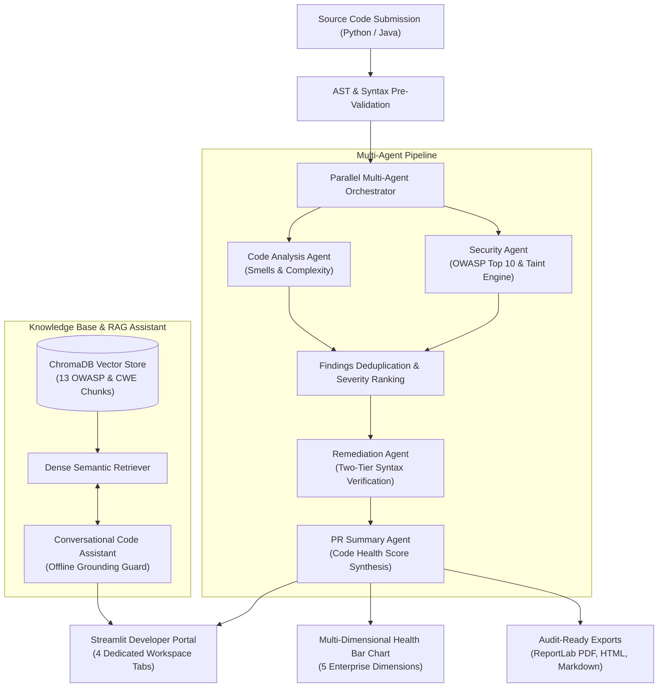

# AI Code Review and Security Analysis Agent

An intelligent, autonomous multi-agent platform designed to perform automated static code review, code smell detection, and security vulnerability analysis for **Python** and **Java** applications.

Grounded in the **OWASP Top 10:2025** security standard, the system combines deterministic Abstract Syntax Tree (AST) analysis with Retrieval-Augmented Generation (RAG) to deliver accurate vulnerability detection, verified remediation patches, enterprise health metrics, and an interactive AI code assistant.

---

## 📌 Project Overview & Problem Statement

In modern software development, code reviews are critical for software quality and security. However:
- **Manual reviews** are time-consuming, inconsistent across engineering teams, and frequently miss subtle security flaws under delivery pressure.
- **Generic Large Language Models (LLMs)** often hallucinate non-existent files, invent library calls, or recommend syntactically broken code.

### How This Project Solves It:
This project solves these challenges by combining **deterministic static code analysis** with **semantic RAG grounding**:
1. **Zero Hallucination Detection:** Uses AST traversal, source-to-sink taint tracking, and Shannon entropy to detect real vulnerabilities at exact line numbers.
2. **Two-Tier Verified Remediation:** Every generated fix is validated through AST syntax compilation and re-scanned by detectors to ensure zero regressions.
3. **Enterprise Health Scoring:** Analyzes code across 5 distinct dimensions (Security, Maintainability, Performance, Complexity, and Reliability) with a clear Quality Gate status.
4. **Interactive Assistance:** An integrated conversational code assistant answers developer queries using a grounded local knowledge base of OWASP and CWE guidelines.
5. **Audit-Ready Exports:** Generates multi-page ReportLab PDF, HTML, and Markdown code review reports.

---

## 🔄 System Architecture & Workflow



---

## 🚀 Key Features & Capabilities

### 1. Multi-Agent Pipeline
- **Code Analysis Agent:** Analyzes Python and Java code for maintainability anti-patterns, god classes, long methods, duplicate code, naming smells, and cyclomatic complexity (>10).
- **Security Vulnerability Agent:** Scans for OWASP Top 10:2025 vulnerabilities including SQL Injection (CWE-89), OS Command Injection (CWE-78), Hardcoded Secrets (CWE-798), Insecure Deserialization (CWE-502), Cross-Site Scripting (CWE-79), SSRF, and broken access control.
- **Remediation Agent:** Provides actionable, side-by-side Before/After code patches with two-tier automated verification.
- **PR Summary Agent:** Computes an overall Code Health Score (0–100), assigns an executive letter grade (A–F), and prioritizes defects by effort and risk.

### 2. Multi-Dimensional Code Health Bar Analysis
Presents real-time scores across 5 core enterprise dimensions:
- 🛡️ **Security (0–100):** Protection against exploit vectors, CVSS severity penalties.
- 🛠️ **Maintainability (0–100):** Clean code structure, modularity, and smell suppression.
- ⚡ **Performance (0–100):** Detection of inefficient nested loops, regex bottlenecks, and I/O traps.
- 🧩 **Complexity (0–100):** Cyclomatic complexity and deep nesting limits.
- 🎯 **Reliability (0–100):** Exception handling, empty catch blocks, and resource leaks.
- **Quality Gate Status:** Real-time compliance badge (🔴 *Failing* / 🟡 *Warning* / 🟢 *Passing* with Grade).

### 3. RAG-Powered Conversational Code Assistant
- Chat with an AI assistant that understands the findings in your code.
- Grounded in an offline **ChromaDB vector store** containing 13 OWASP Top 10:2025 and CWE reference guides.
- **Bottom-Left Floating Shortcut:** A persistent dock button in the bottom-left corner allows 1-click navigation directly to the Assistant from anywhere in the application.

### 4. Comprehensive Report Generation
- **Multi-Page PDF:** 7-section audit report with executive metadata, CVSS distribution charts, detailed finding cards with code snippets, and remediation roadmap.
- **HTML & Markdown:** Self-contained, lightweight exports for CI/CD integration and developer pull requests.

---

## 🛠️ Technology Stack

| Component | Technology | Purpose |
| :--- | :--- | :--- |
| **Language** | Python 3.10+ | Core platform runtime |
| **UI Portal** | Streamlit | Responsive dark-themed developer workspace |
| **Python Parsing** | `ast` standard library | Python AST traversal & taint tracking |
| **Java Parsing** | `javalang` (0.13.0) | Java lexical scanning & AST token visitor |
| **Vector Database** | ChromaDB | Local vector store for secure coding standards |
| **Embeddings** | SentenceTransformers (`all-MiniLM-L6-v2`) | Local semantic embeddings (offline mode) |
| **PDF Generation** | ReportLab & Matplotlib | Audit-ready multi-page report exports |
| **Testing** | pytest (127 tests) | Automated unit, integration, and regression testing |

---

## 💻 How to Run the Project

### Step 1: Clone the Repository
```bash
git clone https://github.com/Nithya-146/Code-Review-and-Security-Analysis.git
cd "Code Review and Security Analysis"
```

### Step 2: Set Up Virtual Environment
```bash
python -m venv venv

# On Windows:
.\venv\Scripts\activate

# On macOS / Linux:
source venv/bin/activate
```

### Step 3: Install Dependencies
```bash
pip install -r requirements.txt
```

### Step 4: Launch the Streamlit Portal
```bash
streamlit run app/app.py
```
Open **`http://localhost:8501`** in your browser.

---

## 🧪 Running Automated Tests

```bash
# Run all 127 automated tests
pytest tests/

# Run the evaluation regression gates
pytest tests/test_eval_regression.py

# Run the evaluation benchmark harness
python tests/eval/evaluation_harness.py
```

---

## 📁 Project Structure

```text
├── agents/             # Multi-agent implementations (Code Analysis, Security, Remediation, PR, Chat)
├── app/                # Streamlit developer portal, UI helpers, and report generators
├── kb/                 # Secure coding knowledge base documents and ChromaDB retriever
├── docs/               # Architecture specs, project reports, and live demo script
├── docs/progress/      # Agile sprint planning, defect tracker, and unit test plan sheets
└── tests/              # 127 automated tests and evaluation regression harness
```

---

## 📄 License

This project is licensed under the [MIT License](../../LICENSE) — see the [LICENSE](../../LICENSE) file for details.

